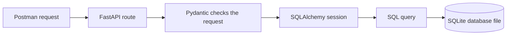
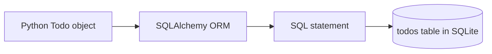
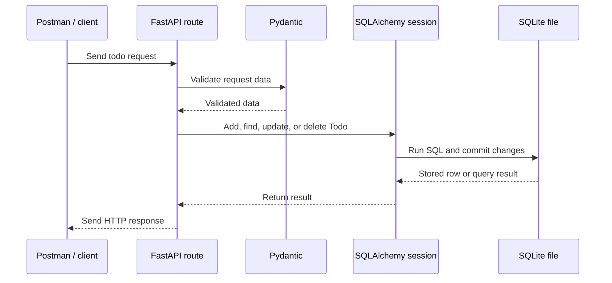

# Section 2 — Give Your Data a Home

> **The journey:** a request arrives, FastAPI validates it, SQLAlchemy translates your Python work into SQL, and SQLite saves the todo in a file.

This section moves your app from a temporary Python list to data that survives a restart.

## The big picture



Each part has a job. FastAPI handles the HTTP request, Pydantic checks API data, SQLAlchemy helps your Python code work with tables, and SQLite stores the records.

## 1. Database, DBMS, tables, and SQL

Think of a relational database like a set of spreadsheets:

| Database idea | Spreadsheet idea | Todo example |
|---|---|---|
| Database | Workbook | `todos.db` |
| Table | Sheet | `todos` |
| Row | One record | One todo |
| Column | A kind of information | `title`, `priority` |
| Primary key | Unique row number | `id` |

A **DBMS** is the software that manages the database. SQLite, MySQL, and PostgreSQL are DBMSs. **SQL** is the language you use to ask a relational database to create, read, update, or delete data.

### The four SQL actions

```sql
-- Create the table
CREATE TABLE todos (
    id INTEGER PRIMARY KEY,
    title TEXT NOT NULL,
    description TEXT,
    priority INTEGER NOT NULL DEFAULT 1,
    complete INTEGER NOT NULL DEFAULT 0
);

-- Create a row
INSERT INTO todos (title, description, priority, complete)
VALUES ('Learn SQL', 'Practice the basics', 2, 0);

-- Read rows
SELECT * FROM todos;
SELECT * FROM todos WHERE id = 1;

-- Update one row
UPDATE todos SET complete = 1 WHERE id = 1;

-- Delete one row
DELETE FROM todos WHERE id = 1;
```

> **Careful:** `UPDATE` or `DELETE` without a `WHERE` condition can affect every row.

## 2. SQLite — the practice database

SQLite keeps the database in a local file, so it is easy to learn with and does not need a separate database server. Your app can close and reopen that file later; the stored todos remain. [SQLite overview](https://www.sqlite.org/about.html)

| Database | Where the data lives | For this course |
|---|---|---|
| SQLite | A local database file | The one you will use |
| MySQL | Usually a database server | Learn the name and concept |
| PostgreSQL | Usually a database server | Learn the name and concept |

The SQL ideas transfer across these systems, though some details differ. Follow the course's **macOS** SQLite installation lesson if the `sqlite3` command is not available.

### Peek inside the database from Terminal

```text
sqlite3 todos.db
.tables
.schema todos
.mode table
SELECT * FROM todos;
.quit
```

This is a useful learning loop: let the FastAPI app write a todo, then open the same `todos.db` file and inspect the row yourself.

## 3. SQLAlchemy — Python's database helper

SQLAlchemy maps Python classes to SQL tables and Python objects to table rows. It can generate SQL for common operations, while the database still stores the information. [SQLAlchemy ORM overview](https://docs.sqlalchemy.org/en/20/orm/)



### The four pieces in `database.py`

| Name | Think of it as | Job |
|---|---|---|
| `engine` | Connection manager | Knows how to reach the database |
| `connect_args` | Connection options | Supplies extra settings; the course uses `check_same_thread: False` for SQLite with FastAPI |
| `SessionLocal` | Session factory | Creates sessions for reading and changing data |
| `Base` | Model registry | Tracks the SQLAlchemy table models and their definitions |

The course's setup looks like this:

```python
from sqlalchemy import create_engine
from sqlalchemy.orm import declarative_base, sessionmaker

DATABASE_URL = "sqlite:///./todos.db"

engine = create_engine(
    DATABASE_URL,
    connect_args={"check_same_thread": False},
)

SessionLocal = sessionmaker(
    autocommit=False,
    autoflush=False,
    bind=engine,
)

Base = declarative_base()
```

A **session** is a short-lived workspace for database operations. It tracks changes, sends them when you commit, and should be closed when the work is done. If something fails, you can roll back uncommitted changes. [SQLAlchemy session basics](https://docs.sqlalchemy.org/en/20/orm/session_basics.html)

## 4. The Todo model — Python description of a table

The model's class maps to a table. Each `Column` describes a table column. A primary key gives each todo a unique ID.

```python
from sqlalchemy import Boolean, Column, Integer, String

from database import Base


class Todo(Base):
    __tablename__ = "todos"

    id = Column(Integer, primary_key=True, index=True)
    title = Column(String, nullable=False)
    description = Column(String)
    priority = Column(Integer, default=1)
    complete = Column(Boolean, default=False)
```

## 5. Create the table when the app starts

```python
Base.metadata.create_all(bind=engine)
```

This creates tables for models registered with `Base` if they do not exist yet. Import the `Todo` model before calling it, so SQLAlchemy knows its definition. It creates missing tables; it does **not** update an existing table when you later change the model.

## 6. Pydantic model versus SQLAlchemy model

These models may have similar fields, but answer different questions:

| Model | Question it answers | Example job |
|---|---|---|
| Pydantic | Is the API request data shaped correctly? | Check a todo title and priority from Postman |
| SQLAlchemy | How is this todo stored in a database table? | Map `Todo` objects to rows in `todos` |

## 7. The request from start to finish



This replaces the in-memory list used by Books. A Python list is temporary; a committed SQLite row survives an app restart.

## Quick self-check

Try explaining these without looking above:

1. What is the difference between SQL and SQLAlchemy?
2. Which component knows how to connect, and which one creates a working session?
3. What does the `Todo` class map to?
4. Why must the model be imported before `create_all`?
5. Why does a committed SQLite todo remain after restarting FastAPI?

## Official references

- [SQLite overview](https://www.sqlite.org/about.html)
- [FastAPI SQL databases guide](https://fastapi.tiangolo.com/tutorial/sql-databases/)
- [SQLAlchemy ORM overview](https://docs.sqlalchemy.org/en/20/orm/)
- [SQLAlchemy session basics](https://docs.sqlalchemy.org/en/20/orm/session_basics.html)
