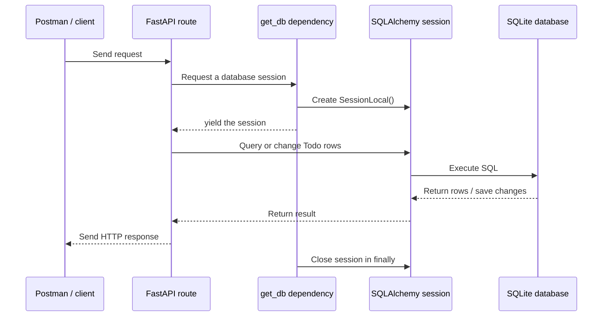

# Section 3 — Todo API Meets the Database

> **The journey:** FastAPI receives a request, Pydantic validates its data, a dependency provides a database session, and SQLAlchemy reads or changes a row in SQLite.

Section 2 introduced SQL, SQLite, the SQLAlchemy engine, sessions, and the Todo table model. Section 3 uses those pieces to build database-backed API endpoints. Unlike the Books feature's Python list, database rows remain after the app restarts.

## The request lifecycle



## 1. One session per request with `Depends` and `yield`

`SessionLocal` creates a session. The FastAPI dependency opens one, gives it to a route with `yield`, and closes it in `finally`. This makes cleanup happen even if the route raises an error. FastAPI supports `yield` dependencies for resources such as database sessions. [FastAPI: Dependencies with yield](https://fastapi.tiangolo.com/tutorial/dependencies/dependencies-with-yield/)

```python
from database import SessionLocal


def get_db():
    db = SessionLocal()
    try:
        yield db
    finally:
        db.close()
```

Routes request the session with `Depends(get_db)`:

```python
from fastapi import Depends
from sqlalchemy.orm import Session


def read_all(db: Session = Depends(get_db)):
    ...
```

`db` is a normal SQLAlchemy `Session`. It lets the route query, add, update, and delete ORM objects. Read-only queries do not need a commit; changes need `db.commit()`. [SQLAlchemy session basics](https://docs.sqlalchemy.org/en/20/orm/session_basics.html)

## 2. Reusable Todo request model

The request model describes the fields a client may send. The database generates `id`, so clients do not need to send it when creating a Todo.

```python
from pydantic import BaseModel


class TodoRequest(BaseModel):
    title: str
    description: str
    priority: int
```

Pydantic validates the request body before the route runs. If a required field is missing or a value is invalid, FastAPI returns a validation response and the route does not perform the database operation.

## 3. Get all Todos — `GET /todos`

```python
@app.get("/todos", status_code=status.HTTP_200_OK)
def read_all(db: Session = Depends(get_db)):
    return db.query(models.Todo).all()
```

The query means “select every Todo row.” If there are no rows, the response is an empty list: `[]`.

## 4. Get one Todo — `GET /todos/{todo_id}`

```python
@app.get("/todos/{todo_id}", status_code=status.HTTP_200_OK)
def read_todo(
    todo_id: int = Path(gt=0),
    db: Session = Depends(get_db),
):
    todo = (
        db.query(models.Todo)
        .filter(models.Todo.id == todo_id)
        .first()
    )

    if todo is None:
        raise HTTPException(status_code=404, detail="Todo not found")

    return todo
```

`todo_id` is a **path parameter** because it is part of the URL. `Path(gt=0)` requires a positive integer; an invalid value gets a validation error. If the ID is valid but no row has that ID, return `404 Not Found`. [FastAPI: Path validation](https://fastapi.tiangolo.com/tutorial/path-params-numeric-validations/)

## 5. Create a Todo — `POST /todos`

```python
@app.post("/todos", status_code=status.HTTP_201_CREATED)
def create_todo(
    todo_request: TodoRequest,
    db: Session = Depends(get_db),
):
    todo = models.Todo(**todo_request.model_dump())
    db.add(todo)
    db.commit()
    db.refresh(todo)
    return todo
```

What happens:

1. FastAPI reads and validates the JSON body as `TodoRequest`.
2. The request data is used to create a SQLAlchemy `Todo` object.
3. `db.add()` marks it for insertion; `db.commit()` writes the row.
4. SQLite generates the primary-key `id`; `db.refresh()` reloads it onto the Python object.
5. The response includes the saved Todo and its generated ID.

## 6. Update a Todo — `PUT /todos/{todo_id}`

`PUT` receives the full set of editable fields. This version returns `204 No Content` on success, so it sends no response body.

```python
@app.put("/todos/{todo_id}", status_code=status.HTTP_204_NO_CONTENT)
def update_todo(
    todo_request: TodoRequest,
    todo_id: int = Path(gt=0),
    db: Session = Depends(get_db),
):
    todo = (
        db.query(models.Todo)
        .filter(models.Todo.id == todo_id)
        .first()
    )

    if todo is None:
        raise HTTPException(status_code=404, detail="Todo not found")

    todo.title = todo_request.title
    todo.description = todo_request.description
    todo.priority = todo_request.priority

    db.commit()
    return Response(status_code=status.HTTP_204_NO_CONTENT)
```

The path ID selects the row. The request body supplies the replacement values. If the row does not exist, raise `404` before changing anything.

## 7. Delete a Todo — `DELETE /todos/{todo_id}`

```python
@app.delete("/todos/{todo_id}", status_code=status.HTTP_204_NO_CONTENT)
def delete_todo(
    todo_id: int = Path(gt=0),
    db: Session = Depends(get_db),
):
    todo = (
        db.query(models.Todo)
        .filter(models.Todo.id == todo_id)
        .first()
    )

    if todo is None:
        raise HTTPException(status_code=404, detail="Todo not found")

    db.delete(todo)
    db.commit()
    return Response(status_code=status.HTTP_204_NO_CONTENT)
```

`db.delete()` marks the row for removal. `db.commit()` makes the deletion permanent. A successful `204` response has no body. [FastAPI: Status codes](https://fastapi.tiangolo.com/tutorial/response-status-code/)

## 8. Imports and app setup

The snippets above assume these names are imported in the file containing the routes:

```python
from fastapi import Depends, FastAPI, HTTPException, Path, Response, status
from sqlalchemy.orm import Session

import models
from database import Base, SessionLocal, engine
from schemas import TodoRequest
```

Importing `models` before table creation registers `Todo` with `Base`. Then the app can create missing tables:

```python
app = FastAPI()
Base.metadata.create_all(bind=engine)
```

Keep `SessionLocal`, `Base`, and `engine` in the shared database module as in Section 2. Keep the Pydantic request model separate from the SQLAlchemy table model.

## 9. What each route returns

| Request | Success | Missing Todo | Body on success |
|---|---:|---:|---|
| `GET /todos` | `200` | Not applicable | List of Todos, possibly `[]` |
| `GET /todos/{id}` | `200` | `404` | One Todo |
| `POST /todos` | `201` | Not applicable | Created Todo, including its generated ID |
| `PUT /todos/{id}` | `204` | `404` | No body |
| `DELETE /todos/{id}` | `204` | `404` | No body |

`204 No Content` specifically means the response has no content. Do not return a JSON message with a `204` response.

## 10. Try the API with curl

Start FastAPI, then create a Todo. Use the ID returned by POST in the later calls:

```bash
curl -i http://127.0.0.1:8000/todos

curl -i -X POST http://127.0.0.1:8000/todos \
  -H "Content-Type: application/json" \
  -d '{"title":"Learn SQLAlchemy","description":"Connect FastAPI to SQLite","priority":2}'

curl -i http://127.0.0.1:8000/todos/1

curl -i -X PUT http://127.0.0.1:8000/todos/1 \
  -H "Content-Type: application/json" \
  -d '{"title":"Learn SQLAlchemy","description":"Update the todo","priority":3}'

curl -i -X DELETE http://127.0.0.1:8000/todos/1
```

You can check the row directly in SQLite with the commands from [Section 2](section-2-sql-database-notes.md).

## Learning checkpoint

Try to explain these without looking above:

1. What does `yield` provide to the route, and why is `db.close()` in `finally`?
2. Why does POST leave `id` out of the request body?
3. What is the difference between an invalid path ID and a valid ID that has no matching row?
4. Why must POST, PUT, and DELETE call `commit()`?
5. Why does a `204` response have no JSON body?

## Official references

- [FastAPI dependencies with yield](https://fastapi.tiangolo.com/tutorial/dependencies/dependencies-with-yield/)
- [FastAPI path parameter validation](https://fastapi.tiangolo.com/tutorial/path-params-numeric-validations/)
- [FastAPI response status codes](https://fastapi.tiangolo.com/tutorial/response-status-code/)
- [SQLAlchemy session basics](https://docs.sqlalchemy.org/en/20/orm/session_basics.html)
